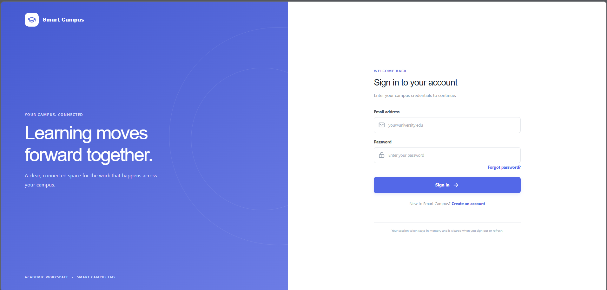
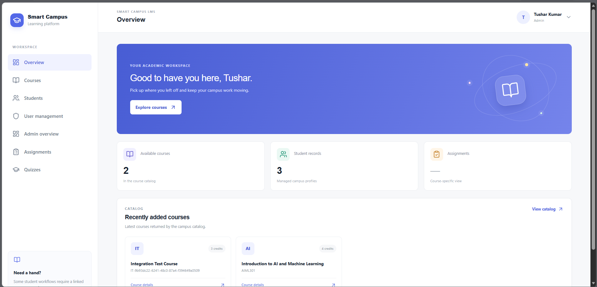
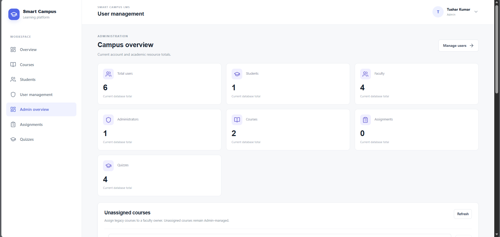
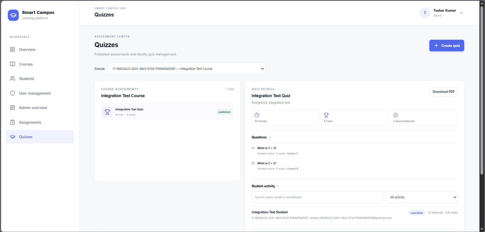
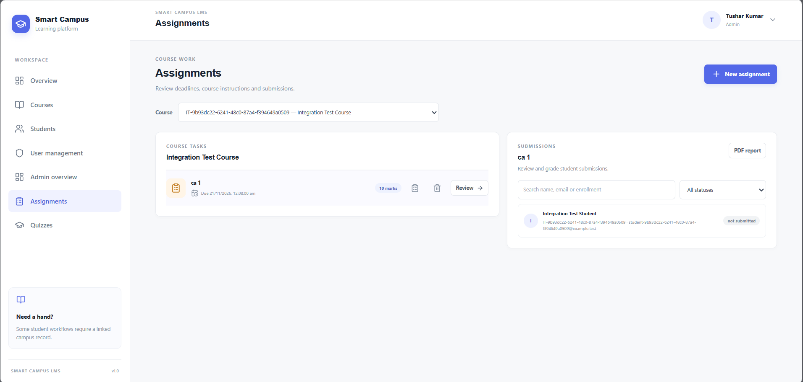

# Smart Campus LMS

Smart Campus LMS is a modern, modular, role-based Learning Management System built for higher education institutions. Powered by a type-safe **TypeScript, Fastify, Prisma ORM, and PostgreSQL** backend and a responsive **React 19, Vite, and TailwindCSS** frontend, it streamlines academic administration, course delivery, continuous assessment, and student learning.

---

## Live Deployment

| Component | Platform | Live Endpoint |
| :--- | :--- | :--- |
| **Frontend Web App** | Vercel | https://smart-campus-lms-gold.vercel.app |
| **Backend REST API** | Render | https://smart-campus-lms.onrender.com |
| **API Swagger Docs** | Render | https://smart-campus-lms.onrender.com/docs |
| **Relational Database** | Neon PostgreSQL | Managed Serverless PostgreSQL (Prisma ORM) |

> **Note:** The backend runs on Render's free tier and may take 30–50 seconds to cold-start after periods of inactivity.

---

## Application Screenshots

### 1. Authentication & Sign-In


### 2. Workspace Overview & Course Catalog


### 3. Admin Campus Overview


### 4. Assessment Center — Quizzes & Results


### 5. Coursework — Assignments & Submissions


---

## Key Features & Architecture

- **Role-Based Access Control (RBAC):** Granular permissions for `admin`, `faculty`, and `student` roles, with token and suspension status re-validated on every request.
- **Course Lifecycle & Approval:** Faculty create courses with syllabus and credit details; administrators review, approve, or reject submissions with feedback before courses enter the campus catalog.
- **Course Materials Management:** Faculty upload lecture notes, slides, and syllabus documents (up to 10 MiB) with secure streaming downloads for enrolled students.
- **Student Enrollment Workflows:** Students browse approved courses, submit enrollment requests, and track status in real time; faculty and administrators review and approve applications.
- **Assignments & Private Submissions:** End-to-end coursework management featuring deadline enforcement, file uploads (PDF/JPEG/PNG/WebP), rubric grading, and personalized feedback.
- **Assessment Engine (Quizzes):** Timed assessments supporting Multiple Choice and True/False questions, question/option illustrations, question bookmarking, attempt resumption, automated scoring, and controlled results release.
- **PDF Report Generation:** Automated server-side generation of A4 landscape PDF gradebooks and rosters for assignments and quizzes.
- **Administrative Operations:** Real-time campus KPI dashboard, user search and role assignment, account suspension, and immutable audit logs.
- **Account Security:** Salted `bcrypt` password hashing, JWT bearer tokens, self-service password updates, and rate-limited 6-digit OTP password recovery.

---

## Documentation

Detailed architectural and developer guides are available in the `docs/` directory:

- **[Project Requirements](docs/PROJECT_REQUIREMENTS.md):** Functional specifications, role definitions, and business rules.
- **[Architecture & Design](docs/ARCHITECTURE.md):** Clean architecture layers, repository patterns, domain models, and data flows.
- **[Development Setup](docs/DEVELOPMENT_SETUP.md):** Node/PostgreSQL prerequisites, Prisma migrations, Docker setup, and seed scripts.
- **[API Reference](docs/API.md):** Complete endpoint catalogue, request/response schemas, error codes, and authentication rules.

---

## Technology Stack

### Backend
| Technology | Purpose |
| :--- | :--- |
| **Node.js & TypeScript** | Strict type-safety, ESM modules, and modern runtime |
| **Fastify** | High-performance, low-overhead HTTP server with plugin architecture |
| **Prisma ORM** | Schema-first database modeling, migrations, and type-safe queries |
| **PostgreSQL** | ACID-compliant relational persistence with unique constraints and partial indexes |
| **Zod** | Runtime schema validation for payloads, query parameters, and environment config |
| **Bcrypt & Fastify JWT** | Salted password hashing, JWT signing, and role claim verification |
| **Vitest** | Fast unit, route, and database integration testing |

### Frontend
| Technology | Purpose |
| :--- | :--- |
| **React 19** | Component-driven UI framework with modern hooks |
| **Vite** | High-speed frontend build tooling and HMR dev server |
| **React Router v7** | Declarative client-side routing with role-based route guards |
| **TailwindCSS & CSS Modules** | Responsive campus styling, design tokens, and modular layouts |
| **Lucide React** | Accessible, consistent iconography |
| **Testing Library & jsdom** | Component regression testing and user interaction verification |

---

## Project Structure

```text
smart-campus-lms/
├── backend/                       # Primary, feature-complete API server
│   ├── prisma/
│   │   ├── schema.prisma          # Database schema (Users, Students, Courses, Quizzes, etc.)
│   │   └── migrations/            # Version-controlled SQL migration scripts
│   ├── src/
│   │   ├── config/                # Environment configuration and validation
│   │   ├── middleware/            # JWT authentication and RBAC authorization
│   │   ├── modules/
│   │   │   ├── admin/             # Dashboard metrics, user role management, audit logs
│   │   │   ├── auth/              # Register, login, password reset OTP, suspension check
│   │   │   ├── assignments/       # Assignment creation, updating, deadlines
│   │   │   ├── submissions/       # Submission upload, download, rubric grading
│   │   │   ├── courses/           # Catalog, course approval workflow, course materials
│   │   │   ├── enrollments/       # Student enrollment requests and approvals
│   │   │   ├── students/          # Student records, enrollment numbers, account linking
│   │   │   ├── quizzes/           # Quiz creation, question image management, publishing
│   │   │   ├── quiz-attempts/     # Active attempts, bookmarks, proctoring events, scoring
│   │   │   └── reports/           # PDF gradebook and roster export
│   │   ├── app.ts                 # Fastify instance builder and plugin registrations
│   │   └── server.ts              # Production HTTP server entry point
│   └── tests/                     # Unit, route, service, and PostgreSQL integration tests
├── frontend/                      # React / Vite SPA web client
│   ├── src/
│   │   ├── api/                   # Type-safe API client wrappers
│   │   ├── components/            # Reusable UI widgets, panels, and layouts
│   │   ├── contexts/              # Authentication and session state
│   │   ├── pages/                 # Route views (Dashboard, Courses, Quizzes, Admin, etc.)
│   │   └── types/                 # TypeScript interfaces for campus entities
│   └── tests/                     # Vitest component and page interaction suites
├── docs/                          # Architecture, API, setup docs, and UI screenshots
│   └── screenshots/               # Application UI screenshots rendered in README
├── DEVELOPMENT_HANDOFF.md         # Operational status and task handoff logs
└── IMPLEMENTATION_TRACKER.md      # Feature implementation tracking checklist