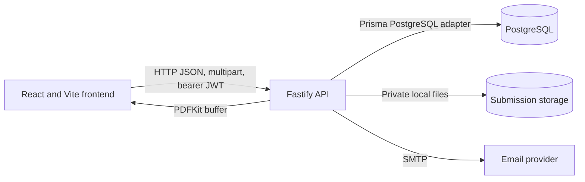

# Smart Campus LMS Architecture

## System Context

The documented, feature-complete system consists of a React/Vite single-page application, a TypeScript/Fastify API, PostgreSQL, and a local private file directory for development. The backend uses Prisma 7 with the PostgreSQL driver adapter. SMTP is an optional external service for password-reset delivery; PDFKit generates reports in the API process.

For local development, Vite proxies API prefixes (including `/reports`) to the backend. In production, serve both applications behind HTTPS and configure the frontend API base/origin and backend network policy explicitly. No production deployment manifest is included.

## Backend Structure and Request Flow

- `src/server.ts` validates runtime environment, constructs the dependency container, starts Fastify, and performs graceful shutdown.
- `src/config/env.ts` uses Zod for required settings, coercion, defaults, and cross-field SMTP validation.
- `src/app.ts` registers JWT, Swagger UI, rate limiting, multipart limits, request logging, health endpoint, routes, and error handling.
- `src/modules/*` separates routes, schemas, services, and repositories by domain.
- `src/container.ts` constructs Prisma, repositories, services, SMTP mailer, local file storage, and PDF report service.
- `src/middleware/authenticate.ts` validates JWT and resolves the actor's current role; `authorize.ts` gates role-specific routes. Services add ownership and enrollment checks.
- `src/errors` and `src/utils` provide application errors, error mapping, and success response helpers.

Request flow: frontend request -> Fastify route/schema -> authentication/role guard -> domain service and ownership policy -> repository -> Prisma -> PostgreSQL. Binary uploads/downloads pass through the submission service and private storage. Report endpoints aggregate domain service data and return generated PDF bytes.

## Frontend Structure

`frontend/src` contains React pages, auth context, layout/UI components, typed API clients, and styling. `src/api/client.ts` adds bearer tokens, parses the shared JSON response shape, handles auth expiry, and supports binary downloads. The UI is not a security boundary; all authorization is enforced by backend routes/services.

## Database Model and Relationships

The Prisma schema is `backend/prisma/schema.prisma`; primary entity IDs are UUIDs unless noted.

- `User` has a unique email and role (`student`, `faculty`, `admin`). It optionally links one-to-one with `Student`; it owns faculty courses and is referenced by password resets and role audits.
- `Student` has unique email, unique enrollment number, and optional unique `userId`; it has enrollments, submissions, and quiz attempts.
- `StudentEnrollmentSequence` stores the next annual counter keyed by year; student creation increments it in a transaction and creates a unique `<prefix><year>-<six digits>` number.
- `Course` has unique course code, optional faculty owner (`User`), enrollments, assignments, and quizzes.
- `Enrollment` links one student to one course; `(studentId, courseId)` is unique.
- `Assignment` belongs to a course and has due date and maximum marks; it has submissions.
- `Submission` links one student and one assignment; `(studentId, assignmentId)` is unique. It stores text, optional file metadata, status, marks, feedback, and timestamps.
- `Quiz` belongs to a course; it owns questions and attempts. Status is draft/published/closed; fields control dates, duration, attempts, marks, and result release.
- `QuizQuestion` belongs to a quiz and stores prompt, four options, correct option, and marks.
- `QuizAttempt` links quiz and student, records state/timestamps/score and activity counts/flag, and owns answers and proctoring events.
- `QuizAnswer` links attempt/question; `(attemptId, questionId)` is unique.
- `ProctoringEvent` belongs to an attempt and stores event type, timestamp, and optional metadata.
- `PasswordResetToken` belongs to a user and stores OTP hash/expiry, failed attempts, reset-token hash/expiry, consumed timestamp, and creation time.
- `RoleAuditLog` links actor and target users and records previous/new roles and timestamp.

Relations use configured cascades for dependent academic records and reset tokens; role audit references restrict user deletion; optional course owner and student account references use `SET NULL`. Review the Prisma schema and migration SQL for exact effects before changing deletion behavior.

## Migration History

Checked-in backend migrations:

- `20261012144353_init`: initial schema.
- `20261027060000_role_audit_password_reset`: role audit and password-reset records.
- `20261028060000_course_ownership_student_enrollment_sequence`: course ownership and annual enrollment sequence.
- `20261028070000_submission_files`: submission file metadata.

Apply in order with `npx prisma migrate deploy` from `backend/`; do not reset a data-bearing database. `prisma generate` generates the Prisma client in `backend/src/generated/prisma` (generated output is ignored).

## Authentication, Authorization, and Data Flows

### JWT and role resolution

Login verifies a bcrypt hash and returns a JWT that expires after one hour. Protected handlers verify bearer tokens; authorization resolves current role from the database for normal production requests, then checks required role and resource-level policy. Public registration always creates a student account. The initial admin is provisioned by a one-time CLI that promotes an existing verified-by-password account, requires an interactive password prompt and explicit one-process opt-in, and refuses after an admin exists.

### Student enrollment and account linkage

Faculty/admin create a student record; the repository atomically increments a year sequence and persists the generated identifier under a unique constraint. Faculty/admin can link an eligible student-role `User` to one `Student`. Student-only routes resolve the linked record from authenticated `sub`; clients cannot choose another student ID to perform privileged actions.

### Assignment submission and grading

Faculty/admin create an assignment for an authorized course. A linked student submits text and may attach one allowed file before the deadline. The backend checks ownership, enrollment, deadline, and duplicate constraints. Faculty/admin view course roster/submissions, download files if authorized, and grade within assignment maximum with optional feedback. Students can retrieve their own records; graded or late workflow restrictions are service-enforced.

### Quiz attempt and activity

Faculty/admin create quizzes and questions, publish them, and configure date/attempt/result settings. Enrolled students start attempts while available, retrieve answer-safe question projections, save A-D answers, submit, and access results only according to release rules. The backend computes/persists results and records client-reported activity events; browser signals should not be treated as secure proctoring evidence.

### Password reset OTP

The API gives a generic response for reset requests. The service generates six-digit OTPs, stores an HMAC digest, applies a resend cooldown and attempt cap, sends mail through SMTP, and returns a short-lived reset token only after correct verification. The database stores a hash of the reset token; successful reset consumes it and stores a bcrypt hash of the new password. SMTP is optional for startup but required for delivery.

### PDF reports

Faculty/admin call assignment or quiz report endpoints. The service verifies resource access, gathers authorized roster/submission/attempt data, and PDFKit renders an A4 landscape attachment. The report endpoints do not stream or expose public files. Generated reports contain sensitive academic data and are not retained by the application.

## Configuration and Limits

Backend startup validates `DATABASE_URL` as a PostgreSQL URL, requires `JWT_SECRET` outside test mode, validates port/host/log level, enrollment prefix, upload directory, and OTP lifetime, and requires SMTP values to be supplied together. Multipart is limited to one file and 10 MiB. Allowed declared MIME types are PDF, JPEG, PNG, and WebP. Local files use generated UUID names and private filesystem modes.

The default local upload directory is `var/private-uploads` relative to the backend process working directory. This implementation is not shared across instances; replace with private durable storage for horizontally scaled deployments. Rate limits use in-process Fastify rate limiting and are not a distributed limiter.

## Reliability, Security, and Known Boundaries

- `/health` performs `SELECT 1`; failures return 503. Shutdown closes Fastify and disconnects Prisma.
- Logs include request ID, method, URL, status, and response time; authorization and cookie headers are redacted.
- Passwords are bcrypt-hashed; OTP and reset values are stored as hashes; frontend API calls do not replace backend policy checks.
- Local file permissions and private download routes protect development files, but there is no object-storage integration, malware scanning, or automated retention process.
- Quiz activity events are client-generated and can be spoofed; they are not a substitute for proctoring controls.
- Data retention periods, backup/restore objectives, production SLOs, deployment infrastructure, CORS/origin hardening, and formal accessibility conformance remain operational/product decisions.
